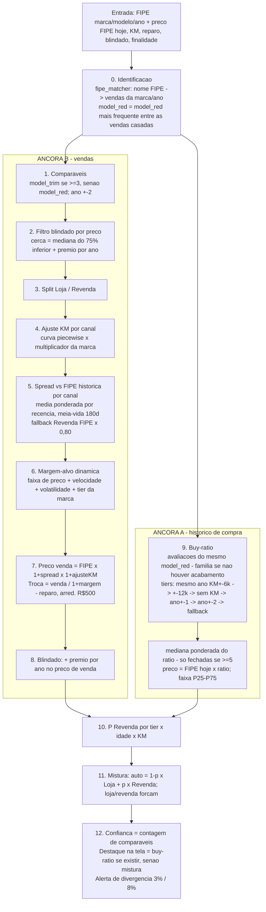

# Revisão do algoritmo de precificação / avaliação de seminovos

Branch: `refactor/precificacao-revisao`. Documento vivo — cada fase acrescenta uma seção.

---

## Fase 1 — Mapa do pipeline (sem alterações de código)

### 1.1 Em uma frase

O avaliador escolhe o carro na tabela FIPE, informa KM, custo de reparo, se é blindado e a
finalidade; o motor produz **duas estimativas independentes de quanto pagar** — (A) "quanto
pagamos historicamente por carros iguais, em % da FIPE" e (B) "por quanto vamos vender menos a
margem que queremos" — mostra as duas, e o número de destaque é (A) quando existe, senão uma
mistura de (B) Loja/Revenda ponderada pela chance de o carro ir para repasse.

### 1.2 Entradas

| Entrada | Onde | Observação |
|---|---|---|
| Marca / modelo / ano-versão FIPE | `dashboard/pages/avaliacao.py` (formulário) | Catálogo e preço via `FipeClient` (`ingestion/fipe_client.py`), preço do **mês de referência atual** |
| KM | formulário | opcional no modelo (`AppraisalRequest.km`), obrigatório na prática |
| Custo estimado de reparo | formulário | subtraído do valor de troca (`analysis/appraisal.py:955-972`) |
| Blindado (sim/não) | formulário | soma prêmio fixo por ano ao preço de venda estimado |
| Finalidade (auto / loja / revenda) | formulário | define como Loja e Revenda são combinados |

**Não existem como entrada:** cor, opcionais, estado de conservação, loja que está avaliando,
procedência (particular × frota), número de donos. O "estado" entra só via custo de reparo.

### 1.3 Bases de dados

| Base | Loader | O que vira |
|---|---|---|
| Vendas realizadas (ERP → `Vendas 2025-2026 processado.xlsx`) | `ingestion/sales_history.py` | `sales_df`: preço de venda, custo, custo ajustado, impostos, canal (Loja/Revenda), D.E, placa, `model_red` (marca + shortname), `model_trim` (`utils/trim_extractor.py`), split de geração (`utils/model_generation.py`) |
| Avaliações (plataforma, Google Sheets + Excel legado 2025) | `ingestion/appraisal_history.py` | `appraisal_df`: status (UTILIZADO / REPASSE / AVALIADO), valor avaliado, FIPE na data, KM, ano, `ratio = avaliado / FIPE`, `weight` por status, `model_red` (marca + família) |
| FIPE | `ingestion/fipe_client.py` | preço atual e **preço histórico por mês** (cache em `.cache/fipe/`, 357 arquivos históricos hoje) |
| Webmotors | `ingestion/webmotors_client.py` | standby (sem chave); não entra no cálculo |
| Feedback "valor real pago" | `ingestion/appraisal_feedback.py` → `data/appraisal_feedback.csv` | **1 linha** registrada até hoje |

Filtros de ingestão que já moldam a base (relevantes para a Fase 2):

- Vendas: `sale_price > 0`, custo e ano presentes (`sales_history.py:120-121`). **Nada filtra
  recompra, carro com problema judicial/garantia, nem D.E absurdo.**
- Avaliações: só UTILIZADO/REPASSE/AVALIADO; `FIPE ≥ 5.000`, `avaliado ≥ 1.000`,
  `0,40 ≤ ratio ≤ 1,30` (`appraisal_history.py:91-94, 189-198`). DESATIVADO e AGUARDANDO MESA
  ficam fora.
- Blindados **não são filtrados na ingestão** — são "detectados" por preço depois (ver 1.4 passo 2).

### 1.4 O motor passo a passo (`analysis/appraisal.py: appraise()`)



**Em linguagem de negócio, passo a passo:**

0. **Que carro é esse na nossa base?** O nome FIPE ("Creta 1.0 TGDI Flex Limited Aut.") é
   quebrado em tokens e casado contra as vendas da marca nos anos ±2 (`utils/fipe_matcher.py:132-263`).
   O `model_red` do pedido passa a ser o mais frequente entre as vendas casadas
   (`avaliacao.py:365-369`). Se nada casa, vira "MARCA + nome FIPE" — que não existe em lugar
   nenhum e o resultado sai "sem dados".
1. **Comparáveis de venda.** Primeiro tenta a versão exata (`model_trim`, mínimo 3 vendas), senão o
   modelo (`model_red`), sempre ano ±2 (`appraisal.py:427-459`).
2. **Tira blindados do conjunto por preço.** Âncora = mediana dos 75% mais baratos; corta quem
   está acima de âncora + prêmio por faixa de ano (45k / 35k / 22,5k; ≤2019 não filtra)
   (`analysis/_blindado.py:66-132`). Feito **antes** de separar Loja e Revenda.
3. **Separa Loja e Revenda** pelo canal da venda.
4. **Ajuste de KM.** Referência = 10 mil km por ano de idade. Depreciação marginal por faixa de KM
   (0,5 / 1,2 / 1,6 / 1,0 / 0,7 pp por 10 mil) vezes um multiplicador por marca e canal
   (`utils/fator_km_preco.py`).
5. **Por quanto vendemos esse modelo em relação à FIPE?** Para cada venda comparável busca a FIPE
   do mês da venda (API, cache) e calcula `preço / FIPE − 1`; faz a **média** ponderada por
   recência (`analysis/_fipe_spread.py:27-93`). Com menos de 3 vendas na Revenda, assume
   FIPE × 0,80; na Loja não há fallback (usa FIPE cheia).
6. **Quanto de margem precisamos nesse carro?** Base pela faixa de preço (Loja 20 % até 60k caindo
   a 10 % acima de 220k; Revenda 6 / 3,5 / 3 %), mais penalidade se o modelo gira devagar
   (mediana de D.E) e se a margem dele é volátil (desvio-padrão), teto 5 pp, mais +2 pp se a
   marca é RISKY (`analysis/dynamic_margin.py`, `utils/brand_tier.py`).
7. **Preço de venda estimado e valor máximo de troca** por canal:
   `venda = FIPE × (1 + spread) × (1 + ajuste KM)`;
   `troca = venda / (1 + margem) − reparo`, arredondado a R$ 500 (`appraisal.py:732-861, 955-977`).
8. **Blindado:** soma prêmio fixo por ano (10–25 mil) ao preço de venda dos dois canais e
   recalcula a troca (`appraisal.py:864-901`).
9. **Quanto pagamos historicamente por esse carro?** Nas avaliações do mesmo modelo (família,
   quando o acabamento não tem histórico) busca em camadas: mesmo ano e KM ±6k → ±12k → mesmo
   ano sem KM → ano ±1 → ano ±2 → qualquer ano ±2. Usa só negócios fechados se houver ≥5, senão
   inclui avaliações não fechadas com peso 0,25. Mediana ponderada do `ratio` e faixa P25–P75;
   preço = FIPE de hoje × ratio (`analysis/purchase_ratio.py`).
10. **Esse carro vai para Loja ou Revenda?** Tabela fixa tier × idade × KM → P(Revenda)
    (`utils/channel_probability.py:103-126`).
11. **Número único:** `auto` mistura Loja e Revenda por P(Revenda); `loja`/`revenda` forçam
    (`appraisal.py:329-422`).
12. **Confiança** = só contagem de comparáveis de venda: 0 → sem dados, <3 → baixa, <9 → média,
    ≥9 → alta (`appraisal.py:980-993`). Na tela, o destaque é o buy-ratio quando existe (mesmo
    divergindo), senão a mistura (`dashboard/pages/_avaliacao/result.py:64-132`); alerta de
    divergência em 3 % e 8 % (`result.py:191-215`).

### 1.5 Inventário de constantes, pesos e thresholds

Legenda da coluna "Fonte": **cfg** = `config.yaml` (lido via `config.py`); **hard** = fixo no código.

#### Identificação e normalização

| Valor | Fonte | Onde | Representa |
|---|---|---|---|
| `score_threshold = 0.6`, exato `1.0`, só-modelo `0.8`, sem-trim `0.65` | hard | `utils/fipe_matcher.py:138, 219-220, 308-327` | pontuação do casamento nome FIPE × venda |
| `_BRAND_ALIASES` (10 marcas) | hard | `fipe_matcher.py:30-41` | FIPE → nome da marca na base |
| `_NOISE_WORDS` (FIPE) / `_NOISE_WORDS` (DealerUp) | hard | `fipe_matcher.py:45-64`, `utils/trim_extractor.py:19-47` | palavras ignoradas ao extrair versão — duas listas quase iguais |
| `_TRIM_ALIASES` (36 entradas), `_TRUNCATION_FIXES` | hard | `trim_extractor.py:51-101` | correções manuais de acabamento |
| 4 regras de geração (Tiguan Allspace, Tucson T-GDI, Yaris Sedan, Outlander Sport) | hard | `utils/model_generation.py:63-103` | separa carros diferentes com o mesmo nome |
| Famílias com acabamento no shortname: CRETA, COROLLA, COROLLA CROSS; extra YARIS CROSS | hard | `utils/model_tagger.py:33-36` | regra de negócio do shortname |
| `year_tolerance = 2` | cfg | `config.yaml:30` | anos ±2 para comparáveis de venda |
| `min_comparables = 3` | cfg | `config.yaml:33` | mínimo p/ usar trim e p/ confiança "média"; ×3 = "alta" (`appraisal.py:991`) |

#### Ingestão / limpeza

| Valor | Fonte | Onde | Representa |
|---|---|---|---|
| `ratio ∈ [0.40, 1.30]`, `FIPE ≥ 5.000`, `avaliado ≥ 1.000` | hard | `ingestion/appraisal_history.py:91-94` | corte de outliers nas avaliações |
| `STATUS_WEIGHTS = {UTILIZADO 1.0, REPASSE 1.0, AVALIADO 0.4}` | hard | `appraisal_history.py:100-104` | **default do loader = 0,4; o config diz 0,25** — a UI passa 0,25, os backtests usam 0,4 |
| `utilizado/repasse/avaliado_weight = 1.0/1.0/0.25` | cfg | `config.yaml:54-58` | pesos efetivos em produção |
| `appraisal_legacy_until = 2026-01-01` | cfg | `config.yaml:38` | corte da mescla Excel legado × planilha |
| regra de canal: vendedor JULIO CESAR SILVEIRA = Revenda | hard | `ingestion/erp_raw_sales.py:40` | canal da venda |

#### Âncora B — vendas

| Valor | Fonte | Onde | Representa |
|---|---|---|---|
| Prêmio de detecção de blindado 45k / 35k / 22,5k (2024+ / 2022-23 / 2020-21), ≤2019 sem filtro; âncora = mediana do quartil inferior (75 %) | **hard** | `analysis/_blindado.py:82-88, 118-120` | cerca para excluir blindados dos comparáveis |
| `blindado_premiums` {45000, 35000, 22500} | cfg | `config.yaml:45-48` | **duplicado do anterior e não é lido por nenhum código** (`AppraisalConfig` não tem o campo) |
| `blindado.premium_by_year` (2014–2026: 10k–25k) | cfg | `config.yaml:163-177` | prêmio somado ao preço de venda de carro blindado |
| `_DEFAULT_BLINDADO_SALE_PREMIUM` | hard | `_blindado.py:29-43` | cópia da tabela acima (fallback) |
| `km_referencia = 10.000 × max(idade, 1)` | hard | `utils/fator_km_preco.py:79-92` | KM "normal" para o ano |
| `FATOR_KM` (14 marcas Loja, 16 Revenda), `FATOR_KM_DEFAULT` Loja 0,021 / Revenda 0,011 | hard | `fator_km_preco.py:32-72` | depreciação por 10k km por marca; no modo curva vira multiplicador relativo ao default |
| `FATOR_ANO = 0.10` | hard | `fator_km_preco.py:74` | **não é usado em lugar nenhum** |
| `km_curve.segments` 0,5 / 1,2 / 1,6 / 1,0 / 0,7 pp por 10k (20k / 50k / 100k / 160k / ∞) | cfg | `config.yaml:116-123` | depreciação marginal por faixa de KM |
| `km_pct_per_10k = 1.0` | cfg | `config.yaml:36` | **passado a `appraise()` e nunca usado** (`appraisal.py:92`) |
| `recency_halflife_days = 180` | cfg | `config.yaml:38` | peso por recência (spread FIPE e mediana ponderada no modo sem FIPE) |
| `year_pct_per_year = 7.5` | cfg | `config.yaml:42` | ajuste de preço por ano de diferença (só no caminho sem FIPE e na escolha da faixa de margem) |
| peso 0,5 para venda sem data | hard | `analysis/_comparable_selection.py:137` | recência desconhecida |
| `fipe_spread.min_sample_for_spread = 3`, `revenda_fallback_ratio = 0.80`, Loja sem fallback | cfg | `config.yaml:69-72` | quando a amostra é pequena |
| Banda P25–P75 só com ≥4 comparáveis e só no modo sem FIPE | hard | `appraisal.py:798` | faixa de troca |
| Arredondamento a R$ 500, `ROUND_HALF_UP` | hard | `appraisal.py:975-977` | docstring diz "para baixo", código arredonda ao mais próximo |
| `loja_target_margin = 15`, `revenda_target_margin = 5.5` | cfg | `config.yaml:31-32` | só valem se `dynamic_margin.enabled = false` |
| `dynamic_margin.loja_bands` 20/14/12/11/10/10 % (60k/90k/120k/160k/220k/∞); `revenda_bands` 6/3,5/3 % (60k/90k/∞) | cfg | `config.yaml:84-96` | margem base por faixa de preço |
| `speed_adjustments` >60d +4, >45 +2, >30 +1; `volatility_adjustments` >8 +3, >6 +2, >4 +1; `max_total_adjustment_pp = 5`; `min_model_sample = 10` | cfg | `config.yaml:79-109` | penalidades por modelo |
| margem "real" para volatilidade = (venda − custo ajustado) / venda, recorte [−30 %, 80 %] | hard | `analysis/dynamic_margin.py:165-167` | **não desconta impostos** (definição do negócio: Venda − Impostos − Custo Ajustado) |
| `brand_tier`: SAFE {TOYOTA, HONDA, HYUNDAI} 0 pp; RISKY {FORD, PEUGEOT, RENAULT, CITROEN} +2 pp; demais 0 | cfg (+ default hard em `utils/brand_tier.py:57-64`) | `config.yaml:131-143` | agressividade por marca |

#### Âncora A — histórico de compra

| Valor | Fonte | Onde | Representa |
|---|---|---|---|
| janelas de KM 6k / 12k / 24k; `min_tier_sample = 5`; `min_fallback_sample = 3` | cfg (+ defaults hard `purchase_ratio.py:46-50`) | `config.yaml:60-64` | tiers de casamento |
| política "só fechadas se ≥5, senão inclui AVALIADO ponderado" | hard | `purchase_ratio.py:395-420` | quais linhas entram na mediana |
| perfil de ano = mediana ponderada do ratio **por ano, na base inteira** (todas as marcas) | hard | `purchase_ratio.py:88-137` | ajuste quando usa anos vizinhos |
| `available` exige `sample_size ≥ 3` | hard | `purchase_ratio.py:71-72` | quando a âncora A aparece |
| fallback para a família quando o acabamento não tem linhas | hard | `purchase_ratio.py` (`_resolve_model_key`) | adicionado em 27/10/2026 |

#### Canal, mistura e confiança

| Valor | Fonte | Onde | Representa |
|---|---|---|---|
| 3 tabelas P(Revenda) tier × idade (0-2/3-4/5-7/8-11/12+) × KM (30k/60k/90k/120k/150k/+) | hard | `utils/channel_probability.py:103-126` | chance de repasse |
| `revenda_profile_threshold = 0.70` | cfg | `config.yaml:155` | badge "perfil Revenda" (só visual) |
| `p_revenda = 0.5` quando indisponível | hard | `appraisal.py:405-407` | mistura neutra |
| confiança: 0 / <3 / <9 / ≥9 comparáveis | hard | `appraisal.py:980-993` | única regra de confiança hoje — **não olha dispersão, recência, nem a âncora A** |
| divergência A×B: <3 % ok, <8 % moderada, ≥8 % alerta | hard | `dashboard/pages/_avaliacao/result.py:200-211` | aviso na tela |
| destaque = buy-ratio sempre que disponível | hard | `result.py:83-88` | docstring diz "quando converge < 8 %", código não checa |

#### Infra FIPE

| Valor | Fonte | Onde |
|---|---|---|
| `_TIMEOUT = 10 s`, catálogo TTL 30 d, referências TTL 2 d, histórico sem TTL | hard | `ingestion/fipe_client.py:21-24, 144` |
| FIPE histórica = tabela do **mês da venda** (não do mês da avaliação/compra) | hard | `fipe_client.py:108-133` |

### 1.6 O que já salta aos olhos (vai para a Fase 2 com impacto e linha)

Só registro aqui para não perder; a classificação por impacto vem na Fase 2.

- Duas âncoras que **não usam a mesma noção de "carro"**: B casa por versão (trim) quando pode;
  A casa por família. E a confiança ignora A.
- O ajuste de **ano entra duas vezes** quando a âncora A usa anos vizinhos: o `ratio` já é relativo
  à FIPE do ano daquele carro (que embute a depreciação) e ainda soma um delta de perfil de ano.
- **Spread FIPE é média** (sensível a outlier) enquanto todo o resto é mediana.
- **Margem usada na volatilidade não desconta impostos**; a margem do negócio desconta.
- `blindado_premiums` no config é letra morta; `km_pct_per_10k` idem; `FATOR_ANO` idem;
  `taxes` é carregado e nunca usado.
- Peso de AVALIADO: 0,25 em produção, 0,4 nos backtests existentes.
- Confiança por contagem apenas; destaque na tela não checa convergência (apesar do comentário).
- Nenhum filtro de recompra / judicial / garantia / D.E extremo na base de vendas; blindado é
  inferido por preço (com Loja e Revenda misturados na âncora da cerca).
- Backtests existentes usam **split aleatório** e medem contra o *valor avaliado* (o que pagamos),
  não contra a margem realizada.

### 1.7 Dúvidas a resolver antes da Fase 3 (não assumir)

1. **Qual é o "valor real" da meta ±5 %?** Candidatos: (a) o valor que de fato pagamos pelo carro
   (Valor Avaliado UTILIZADO / Custo na venda); (b) o custo que teria entregue a margem-alvo na
   venda real, isto é `Vl Venda − Vl Impostos − margem-alvo` — "quanto deveríamos ter pago";
   (c) a margem realizada se tivéssemos pago o valor sugerido. (b)/(c) são equivalentes e batem
   com "margem final que vendemos depois".
2. **Margem**: `Marg. Ini. = Vl Venda − Vl Impostos − Custo Ajustado`, ignorando Despesa
   Operacional e O. Custo? (É a regra do blueprint de relatórios; o código hoje ignora impostos.)
3. **Repasse** no alvo: carro que foi para Revenda conta com a margem de Revenda (≈3–6 %) ou fica
   fora da meta de ±5 %?
4. **Margem-alvo** para (b): a dinâmica por faixa (config) ou um valor fixo por canal?

**Respostas (27/10/2026):** (1) = (b), custo que teria entregue a margem-alvo na venda real;
(2) sim, `Marg. Ini. = Vl Venda − Vl Impostos − Custo Ajustado`; (3) Revenda entra, com meta de
**no mínimo zerar depois do imposto, idealmente ganhar um pouco**; (4) em aberto — a Fase 3 mede
contra a margem realizada e reporta por canal, sem depender da margem-alvo do config.

---

## Fase 2 — Diagnóstico

Base usada para os números: `Vendas 2025-2026 processado.xlsx` (5.837 vendas) e a base de
avaliações mesclada (30.147 linhas; 5.027 UTILIZADO + 1.013 REPASSE). Impacto = efeito esperado
na precisão do valor sugerido (Alto / Médio / Baixo).

### 2.1 Fatos da base que condicionam tudo

| # | Fato | Número | Consequência |
|---|---|---|---|
| F1 | Avaliação fechada ↔ venda posterior casam por placa | **5.178 de 6.040** fechadas; lag mediano 38 d (P25 22, P75 72) | dá para medir margem realizada por avaliação — é o alvo da Fase 3 |
| F2 | `Valor Avaliado` ≡ `Custo Ajustado` da venda | iguais em **93,7 %** (±2 %) | "o que pagamos" está nas duas bases; `ratio` é confiável |
| F3 | Impostos sobre a venda | mediana **2,2 % Loja / 1,8 % Revenda**, nenhuma venda com imposto zero | ignorar imposto desloca a margem em ~2 pp |
| F4 | Margem realizada após imposto, por canal | Loja mediana **10,2 %** (P10 3 %, P90 17,5 %, 5,7 % negativas); Revenda mediana **2,4 %** (P10 −4,1 %, **24,5 % negativas**) | meta de Revenda "zerar" é atingida em 75 % dos casos hoje |
| F5 | Margem Loja por faixa de preço (realizada, após imposto) | ≤60k 18,7 % · 60–90k 12,4 % · 90–120k 9,7 % · 120–160k 8,9 % · 160–220k 8,1 % · >220k 9,9 % | as bandas do config (20/14/12/11/10) estão acima do realizado em toda faixa — ver D4 |
| F6 | Mesma placa avaliada várias vezes | **3.887 placas** com 2+ avaliações (9.547 linhas); 1.719 placas têm fechada **e** AVALIADO | o mesmo carro entra mais de uma vez na mediana do buy-ratio e vaza entre treino/teste |
| F7 | Perfil de ano do ratio é global | global 2022 = 0,815; BYD 2022 = **0,593**; Toyota 2022 = 0,860 | o ajuste de ano do buy-ratio aplica um delta "médio do grupo" a marcas que se comportam de forma oposta |
| F8 | Vendas sem acabamento identificado | 18,8 % com `model_trim == model_red` | casamento por versão falha silenciosamente nelas (score 0,65) |
| F9 | Cauda longa de modelos | 176 de 355 modelos com <5 vendas (346 vendas, 6 %) | qualquer regra de confiança por contagem já cobre ~94 % das vendas — a meta de 50 % não é limitada por volume |
| F10 | Recompra / estoque parado | 60 placas vendidas 2×; 121 vendas com D.E > 180 d; 135 com D.E = 0 | pequeno, mas hoje entra sem filtro nos comparáveis e na margem dinâmica |

### 2.2 Bugs e inconsistências

| ID | Impacto | Onde | O que acontece |
|---|---|---|---|
| **B1** | **Alto** | `analysis/appraisal.py:684-691` → `analysis/_fipe_spread.py:71-73` | O spread vs FIPE de **cada comparável** é calculado com a FIPE do **ano do carro avaliado** (`fipe_year_code` do pedido), não do ano do comparável. Com comparáveis de ano ±2, um 2022 vendido a preço de 2022 é comparado à FIPE de um 2020 → spread inflado em ~+15 %; um 2018 → −15 %. O resultado depende do mix de anos dos comparáveis e cancela só por sorte. |
| **B2** | **Alto** | `analysis/appraisal.py:955-972` vs `analysis/dynamic_margin.py:165` vs `config.yaml:84-96` | Três definições de margem convivem: a troca é calculada como **markup sobre o custo** (`venda / (1 + m)`), a volatilidade usa **margem sobre a venda sem imposto**, e as bandas foram "calibradas a partir das vendas reais" (margem sobre a venda **com** imposto, F5). Markup 14 % = margem/venda 12,3 %; menos 2,2 % de imposto = 10,1 % líquido. O número que o avaliador lê como "margem 14 %" entrega ~10 %. |
| **B3** | **Alto** | `analysis/purchase_ratio.py:88-137` (`compute_year_ratio_profile`) | Ajuste de ano usa a mediana do ratio **por ano na base inteira** (F7). Para BYD o delta real 2022→2023 é +0,19; o global é +0,02. O delta é somado ao ratio sem limite — pode sair da faixa [0,40; 1,30] que a ingestão impõe. Só afeta tiers 4–6 (anos vizinhos). |
| **B4** | **Médio** | `ingestion/appraisal_history.py` (sem dedup) + `purchase_ratio.py:395-420` | F6: o mesmo carro aparece como AVALIADO em 2–3 lojas e depois UTILIZADO. No caminho "só fechadas" não distorce; no fallback com AVALIADO, o mesmo carro conta várias vezes (peso 0,25 cada) e puxa a mediana para a oferta que **não** fechou. |
| **B5** | **Médio** | `analysis/_blindado.py:118-122` chamado em `appraisal.py:131` **antes** do split por canal | A âncora da cerca mistura Loja e Revenda (Revenda vende ~19 % abaixo). Em carro caro o prêmio fixo (45k) é pequeno em relação ao preço: Loja a R$ 320k com âncora puxada a R$ 270k pelas Revendas → vendas Loja legítimas acima de R$ 315k saem como "blindado". Em carro barato (<80k) a cerca praticamente nunca corta. O campo `Situação NBS = BLINDADO` existe na base (91 vendas) e não é usado. |
| **B6** | **Médio** | `utils/fator_km_preco.py:79-92` + `appraisal.py:616-644` | O ajuste de KM compara o carro avaliado com uma referência abstrata (10 mil km/ano), mas o preço-base vem de comparáveis **cuja KM não é normalizada**. Se os comparáveis rodaram em média 70 mil e o avaliado 50 mil, o ajuste correto é +~3 %; o código aplica o ajuste vs 60 mil (referência) → metade. Dois efeitos de KM que não conversam. |
| **B7** | **Médio** | `analysis/_fipe_spread.py:88-93` | Spread é **média** ponderada; todo o resto do motor usa mediana. Um comparável mal casado (versão errada, blindado que passou a cerca) move a média. |
| **B8** | **Médio** | `appraisal.py:427-446` | Com ≥3 vendas da versão, usa só elas e descarta as 40 da família. Três vendas definem o spread e a margem. Não há mistura versão+família por volume. |
| **B9** | **Baixo** | `appraisal.py:975-977` | `_round_to_500` usa `ROUND_HALF_UP`; docstring e comentário dizem "para baixo (conservador)". |
| **B10** | **Baixo** | `analysis/_comparable_selection.py:100-103` | `year_adjusted_prices` é linear (×(1 + n·7,5 %)): 2 anos para baixo = 0,85, para cima = 1,15 — assimétrico vs. composto. Só no caminho sem FIPE. |
| **B11** | **Baixo** | `dashboard/pages/_avaliacao/result.py:64-93` | Docstring: destaque = buy-ratio "quando converge (<8 %)"; código usa buy-ratio sempre que existe. Divergência de 20 % ainda mostra o buy-ratio como principal. |
| **B12** | **Baixo** | `models/appraisal.py:78` / `_rationale.py` | `outliers_removed` descrito como "IQR filter"; é a cerca de blindado. `Comparable.margin_percent` é `% MF` (após O. Custo), não a margem oficial. |

### 2.3 Redundâncias e código morto

| ID | Impacto | Onde | O quê |
|---|---|---|---|
| R1 | Médio (confusão) | `config.yaml:45-48` × `_blindado.py:82-88` | `blindado_premiums` no config não é lido; a tabela real está hard-coded. Mudar o config não muda nada. |
| R2 | Médio | `ingestion/appraisal_history.py:100-104` × `config.yaml:58` | Peso AVALIADO 0,4 (default) × 0,25 (config). Backtests existentes rodam com 0,4 — medem outro algoritmo. |
| R3 | Baixo | `config.yaml:36` / `appraisal.py:92` | `km_pct_per_10k` passado e nunca usado. |
| R4 | Baixo | `utils/fator_km_preco.py:74` | `FATOR_ANO = 0.10` sem uso. |
| R5 | Baixo | `ingestion/sales_history.py:29` | `taxes` carregado e nunca usado (ver B2 — deveria ser). |
| R6 | Baixo | `appraisal.py:43-49` | `_blindado_premium` importado sem uso; alias `_remove_blindados` de compatibilidade. |
| R7 | Baixo | `appraisal.py:591-613` × `732-778` | `_estimate_sale_price_for_margin` reimplementa `_channel_price` (mesma fórmula, duas vezes). |
| R8 | Baixo | `config.yaml:31-32` | `loja/revenda_target_margin` só valem com `dynamic_margin.enabled=false`; UI mostra os dois. |
| R9 | Baixo | `utils/fipe_matcher.py:45-64` × `utils/trim_extractor.py:19-47` × `utils/model_tagger.py:22-29` | Três listas de "palavras de ruído" para o mesmo fim, divergentes entre si. |
| R10 | Baixo | `utils/fator_km_preco.py:32-72` + `config.yaml:116-123` + `utils/brand_tier.py` + `channel_probability.py` | Quatro mecanismos independentes encodam "marca" (fator KM por marca, tier, tabela de canal por tier, spread por modelo). Efeito de marca entra por quatro portas. |
| R11 | Baixo | `tests/backtests/*.py` | Scripts apontam para `Relatorio vendas 20255 processado.xlsx` (arquivo antigo) e split aleatório; precisam ser substituídos pelo backtest da Fase 3. |

### 2.4 Riscos estatísticos

| ID | Impacto | Onde | Risco |
|---|---|---|---|
| **S1** | **Alto** | `tests/backtests/backtest_calibration.py:120-131`, `backtest_by_channel.py:154-162` | **Split aleatório** por linha + F6: o mesmo carro (AVALIADO ontem, UTILIZADO hoje) cai em treino e teste. O MAPE reportado é otimista. Nada no repositório mede com split temporal. |
| **S2** | **Alto** | `appraisal.py:980-993` | Confiança = contagem de vendas comparáveis. Não considera dispersão dos preços, recência, se as duas âncoras convergem, nem se o buy-ratio veio de tier 1 ou do fallback. "Alta" com 9 vendas de versões misturadas é comum. **Hoje não existe nada que diga "pode confiar sem revisão".** |
| **S3** | **Alto** | `analysis/dynamic_margin.py:74-96` | Estatísticas do modelo (mediana de D.E, std da margem) usam **toda a história** sem janela temporal nem ponderação; um modelo que girava devagar em 2025 e rápido em 2026 recebe a penalidade de 2025. |
| **S4** | **Médio** | `purchase_ratio.py:395-420` | Política "≥5 fechadas → só fechadas; senão tudo com peso". Descontinuidade: 5 fechadas usam 5 linhas; 4 fechadas + 30 AVALIADO usam 34 com 30 ofertas rejeitadas (mediana AVALIADO 0,782 vs fechadas 0,825 — F6/F2). |
| **S5** | **Médio** | `appraisal.py:136-137` + `sales_history.py` | Base de vendas inclui recompras, D.E > 180 d e carros com margem negativa severa sem marcação (F10). Comparável que ficou 300 dias no pátio e saiu com desconto define o spread do modelo. |
| **S6** | **Médio** | `utils/channel_probability.py:103-126` | Tabela P(Revenda) calibrada uma vez (abr/2026, 2.280 vendas) e congelada no código; não se atualiza com a base e não usa modelo/versão — só tier da marca. |
| S7 | Médio | `appraisal.py:798` | Banda P25–P75 da troca só existe no modo sem FIPE; em produção (sempre FIPE) **não há intervalo** para a âncora B. A âncora A tem P25–P75 do ratio, mas sem calibração (não se sabe que % dos casos reais cai dentro). |
| S8 | Baixo | `_comparable_selection.py:137` | Venda sem data recebe peso 0,5 arbitrário. |
| S9 | Baixo | `utils/fipe_matcher.py:132-195` | Quando nenhuma venda da marca/ano existe, devolve vazio e o `model_red` vira "MARCA + nome FIPE"; o buy-ratio só funciona por causa do fallback de família adicionado em 27/10. |

### 2.5 Performance (relevância baixa)

| ID | Onde | O quê |
|---|---|---|
| P1 | `_fipe_spread.py:61-83` | Uma chamada de FIPE histórica por comparável (até ~80 por avaliação). Com cache em disco fica rápido na segunda vez; a primeira leva 20–40 s. Um backtest com milhares de avaliações precisa pré-carregar a FIPE histórica por (modelo, ano, mês) em lote. |
| P2 | `_comparable_selection.py:134`, `_fipe_spread.py:61`, `fipe_matcher.py:198` | `iterrows`/`apply` linha a linha; irrelevante na UI, relevante no backtest. |
| P3 | `dynamic_margin.py:145-152` | Filtra a base inteira (string upper) a cada chamada, duas vezes por avaliação. |

### 2.6 Resumo por impacto

- **Alto (precisão):** B1 (FIPE do ano errado no spread), B2 (três definições de margem; imposto
  ignorado), B3 (perfil de ano global), S1 (backtests sem split temporal, vazamento por placa),
  S2 (confiança só por contagem), S3 (estatísticas do modelo sem janela).
- **Médio:** B4, B5, B6, B7, B8, R1, R2, S4, S5, S6, S7.
- **Baixo:** o restante — limpeza de código e consistência de documentação.

A Fase 3 mede o algoritmo **como está** (incluindo B1–B3) para a régua ser honesta; cada correção
da Fase 4 entra uma por vez contra essa régua.

---

## Fase 3 — Baseline (backtest temporal)

Reproduzível com um comando (≈4 min): `py -3.12 scripts/backtest.py --label baseline`.
Código em `grand_brasil/backtest/` (dataset, tabela FIPE offline, runner, métricas; 13 testes).
Saídas em `backtest_results/baseline_{summary.md,predictions.csv}`.

### 3.1 Método

- **Unidade:** avaliação fechada (UTILIZADO/REPASSE) de 01/01 a 31/10/2026 cuja placa aparece numa
  venda posterior (lag ≤ 365 d; mediano 36 d, P90 93 d) → **2.138 casos** (1.075 Loja, 1.063
  Revenda; 986 com custo de reparo informado; 10 blindados). Outubro quase não entra porque as
  vendas ainda não aconteceram.
- **Split temporal (walk-forward por mês):** para um caso de março/2026, o motor só vê vendas e
  avaliações datadas antes de 01/03/2026 e **nunca as avaliações anteriores do próprio carro**.
  Treino mínimo = 2025 inteiro.
- **Alvo:** `custo_ideal = Vl Venda − Vl Impostos − margem_alvo × Vl Venda`. Margem-alvo Loja =
  mediana realizada por faixa de preço nas vendas **anteriores ao teste** (≤60k 19,0 % · 60–90k
  12,3 % · 90–120k 10,0 % · 120–160k 9,2 % · 160–220k 8,9 % · >220k 10,4 %); Revenda = 0 %.
- **Previsão:** exatamente o número que a tela destaca (buy-ratio quando existe — 2.041 casos —,
  senão a mistura Loja/Revenda), com finalidade `auto`, KM, reparo e blindado da avaliação,
  FIPE da data da avaliação, `model_red` da venda (equivale ao que o matcher FIPE resolve).
- **FIPE histórica offline:** a API não é viável para 56 mil consultas; a tabela usa a FIPE
  observada na própria base de avaliações por (família, ano, mês) — 12.476 combinações, 97,7 % de
  acerto nas consultas. Reproduz o comportamento atual (inclusive o bug B1, porque a consulta usa
  o ano do carro avaliado, como em produção).
- **Métricas:** erro = (previsto − custo_ideal) / custo_ideal; MAPE, mediana, viés, P10/P90,
  % dentro de ±3/±5/±10 %, e "margem que teria sobrado se pagássemos o previsto".

### 3.2 A régua

| | n | MAPE | mediana | viés | ±3 % | ±5 % | ±10 % | margem se pagasse |
|---|---|---|---|---|---|---|---|---|
| **Algoritmo atual** | 2.138 | **7,9 %** | 0,0 % | +0,2 % | 31 % | **47 %** | **73 %** | +6,7 % (negativa em 30 %) |
| Algoritmo — Loja | 1.075 | 6,6 % | −0,6 % | −1,5 % | 38 % | 55 % | 80 % | +11,1 % |
| Algoritmo — Revenda | 1.063 | 9,1 % | +1,2 % | +1,9 % | 24 % | 39 % | 67 % | −1,2 % |
| *Avaliador humano (o que pagou)* | 2.138 | *5,0 %* | *−1,6 %* | *−1,4 %* | *41 %* | *62 %* | *89 %* | *+8,4 %* |
| *Humano — Loja* | 1.075 | *4,8 %* | *0,0 %* | *0,0 %* | *45 %* | *66 %* | *89 %* | |
| *Humano — Revenda* | 1.063 | *5,2 %* | *−3,0 %* | *−2,8 %* | *37 %* | *58 %* | *89 %* | |

Leitura honesta da linha "humano": o preço de venda é negociado **sabendo** quanto se pagou, e a
margem-alvo foi tirada das vendas que esses mesmos avaliadores fecharam — a régua humana é
parcialmente endógena e deve ser lida como teto prático, não como adversário. Ainda assim, o
avaliador erra menos que o algoritmo em todos os cortes, e **mesmo ele fica em 62 % dentro de
±5 %**: a dispersão do próprio preço de venda (negociação, dia, loja) impõe um piso de ruído.

Incluir as avaliações anteriores do mesmo carro no treino (como os backtests antigos faziam) muda
o MAPE em 0,1 pp — o vazamento por placa quase não aparece no buy-ratio porque, com ≥5 fechadas,
as AVALIADO são ignoradas.

### 3.3 Onde o erro está

**Por tier do buy-ratio (o que determina a qualidade hoje):**

| tier | n | MAPE | mediana | ±5 % | ±10 % | P10 / P90 |
|---|---|---|---|---|---|---|
| mesmo ano, KM ±6k | 904 (42 %) | **5,3 %** | +0,2 % | 60 % | 87 % | −7,3 % / +9,0 % |
| mesmo ano, KM ±12k | 268 | 5,8 % | −0,2 % | 58 % | 82 % | −8,9 % / +9,4 % |
| ano ±1, KM ±12k | 77 | 8,0 % | +1,0 % | 49 % | 71 % | −12,8 % / +10,4 % |
| **mesmo ano, sem KM** | 557 (26 %) | **10,1 %** | +1,0 % | 33 % | 60 % | −15,7 % / +16,5 % |
| ano ±2, KM ±24k | 102 | 10,1 % | −6,3 % | 32 % | 61 % | −17,5 % / +7,3 % |
| fallback do modelo | 133 | 12,6 % | −5,9 % | 22 % | 45 % | −20,9 % / +15,1 % |
| sem buy-ratio (mistura) | 97 | 15,6 % | +5,4 % | 27 % | 51 % | −13,3 % / +34,5 % |

Dois sinais claros: (a) **KM importa mais que ano** — "ano ±1 com KM" erra menos que "mesmo ano
sem KM", mas a ordem dos tiers prefere o segundo; (b) os tiers com ajuste de ano (±2, fallback)
têm **viés de −6 %** — é o B3 (perfil de ano global) aparecendo.

**Por canal/status:** Revenda é onde o algoritmo mais erra (MAPE 9,1 %, ±5 % 39 %) e paga
sistematicamente acima do ideal (viés +1,9 %; REPASSE +3,5 %); 30 % dos casos teriam margem
negativa. O buy-ratio não sabe para onde o carro vai — P(Revenda) só entra na mistura, que é o
destaque em 5 % dos casos.

**Por ano / KM / preço:** ≤2017 (MAPE 10,8 %, viés −2,8 %), >100 mil km (9,6 %, margem se
pagasse −0,2 %), ≤60k (10,5 %) e >220k (12,1 %) são as pontas ruins. 2023+ tem viés **+2,1 %**
(paga demais em carro novo), ≤2017 **−2,8 %** (paga de menos em carro velho) — consistente com
ajuste de ano/KM mal dosado.

**Por marca:** BYD 4,2 % (±10 % 95 %), Hyundai 6,5 %, Honda 6,2 %, VW 6,8 %; BMW 12,0 % e
Audi 13,8 % (viés −3 %). **Por filial:** as BYD/Toyota/Hyundai 6,9–8,2 %; BMW Gastão 11,6 %,
BMW Alphaville 12,8 %. **Por volume do modelo no treino:** 50+ vendas 6,9 %, 20–49 7,2 %, 5–19
8,2 %, 0–4 12,2 % — volume ajuda, mas pouco além de 20.

**Por mês:** estável entre 7,1 % e 8,6 % — sem drift ao longo de 2026.

### 3.4 Quanto os sinais atuais conseguem isolar (ponto de partida da camada de confiança)

| subconjunto (sinais já existentes) | cobertura | ±5 % | ±10 % | MAPE |
|---|---|---|---|---|
| tier KM ±6k | 42 % | 60 % | 87 % | 5,3 % |
| tier KM ±6k ou ±12k | 55 % | 60 % | 86 % | 5,4 % |
| … & confiança "alta" | 50 % | 60 % | 86 % | 5,3 % |
| … & ≥10 fechadas | 5 % | 69 % | 86 % | 4,9 % |
| divergência A×B ≤ 3 % | 15 % | 62 % | 84 % | 5,7 % |
| divergência ≤ 5 % & tier KM & faixa P25–P75 estreita | 13,5 % | 68 % | 89 % | 4,9 % |

A "confiança alta" atual (contagem de vendas) **não separa nada**: dentro do tier KM, "alta"
tem a mesma precisão que o resto. O tier do buy-ratio é o único sinal que hoje discrimina.

### 3.5 O que isso diz sobre a meta

A meta "50 % das avaliações com 90 % dentro de ±5 %" **não é atingível com estes dados**, por
dois motivos que não dependem do algoritmo: (1) nem o avaliador humano, com informação que o
modelo não tem (estado do carro, negociação), passa de 62–66 % dentro de ±5 %; (2) o alvo é o
preço de uma venda futura negociada, cuja dispersão intrínseca já consome boa parte dos ±5 %.

Fronteira realista a perseguir na Fase 4, a calibrar de verdade com intervalos conformes:
- **alta confiança:** ≥ 50 % de cobertura com **≥ 90 % dentro de ±10 %** e **≥ 65–70 % dentro de
  ±5 %** (hoje o melhor subconjunto com 50 % de cobertura dá 86 % / 60 %);
- "±5 % em 90 %" só deve ser prometido num núcleo pequeno (provavelmente < 15 % das avaliações:
  modelos de altíssimo volume, mesmo ano, KM na faixa, canal Loja).

Tudo na Fase 4 é medido contra a linha **Algoritmo atual: MAPE 7,9 % · ±5 % 47 % · ±10 % 73 % ·
viés +0,2 %**, e separadamente por canal.

---

## Fase 4 — Melhorias (cada uma isolada, contra a régua)

Mesmo backtest da Fase 3 (2.138 casos de 2026, walk-forward mensal). Cada linha é um
`--set` sobre o `config.yaml`; a última coluna diz se entrou. Regra: só entra o que melhora a
régua; empate técnico fica de fora (ou entra só como correção, marcado).

### 4.1 Experimentos

| # | mudança | MAPE | ±3 % | ±5 % | ±10 % | viés | decisão |
|---|---|---|---|---|---|---|---|
| — | **régua (algoritmo atual)** | 7,9 % | 31 % | 47 % | 73 % | +0,2 % | |
| 1a | tiers do buy-ratio em ordem **KM-first** (ano vizinho com KM casado antes de mesmo ano sem KM) | 7,4 % | 33 % | 49 % | 75 % | −0,2 % | **entra** |
| 1b | peso por recência no buy-ratio (meia-vida 180 d / 365 d) | 8,0 % / 7,9 % | 30 % | 47 % | 73 % | +0,4 % | fora |
| 1c | **ajuste de KM dentro do tier** (slope pooled ratio×KM, −pp/10k) | 7,3 % | 32 % | 50 % | 75 % | −0,3 % | **entra** |
| 1a+1c | | 7,2 % | 32 % | 50 % | 76 % | −0,5 % | base dos seguintes |
| 2 | perfil de ano **por marca** (B3) sobre 1a+1c | 7,2 % | 32 % | 49 % | 76 % | −0,5 % | fora (neutro; o viés dos tiers de ano vizinho não era mix de marca) |
| 3 | desconto por canal (k·P(Revenda), k = 2–8 %) — testado offline, inclusive com o canal **real** | ≥ 7,8 % | | | | | fora — o motor já prevê ratio menor para repasse; o erro da Revenda é dispersão, não viés |
| 3' | **ensemble 70 % âncora A + 30 % âncora B** (sozinho) | 7,0 % | 33 % | 51 % | 79 % | 0,0 % | **entra** (curva plana entre 0,6 e 0,8) |
| 3'+1ac | ensemble sobre 1a+1c | **6,7 %** | 33 % | 52 % | 80 % | −0,5 % | base dos seguintes |
| 4a | FIPE do **ano do próprio comparável** no spread (B1) | 6,7 % | 33 % | 52 % | 79 % | −0,4 % | entra **como correção** (neutro no destaque: a âncora B pesa 30 % e o erro cancelava na média) |
| 4b | spread por **mediana** em vez de média (B7) | 6,7 % | 33 % | 51 % | 79 % | −0,5 % | fora |
| 4c | margem sobre a **venda, com 2 % de imposto** (B2), bandas atuais | 6,8 % | 32 % | 49 % | 79 % | −1,5 % | fora como está — só desloca para baixo; exige recalibrar as bandas (ver 4.5) |
| 5a | **shrinkage** da mediana do buy-ratio para a referência do ano, peso n/(n+k), k = 3 | **6,6 %** | **35 %** | **53 %** | **80 %** | +0,1 % | **entra** (pequeno, mas melhora tudo e zera o viés dos tiers de ano vizinho: −2,1 → −1,1 %, −3,1 → −1,3 %) |
| 5b | shrinkage k = 6 / 10 | 6,7 % | 35 % | 53 % | 80 % | +0,3 % | fora |
| 5c | ajuste de ano ×0 / ×0,5 (zerar ou reduzir o delta do perfil de ano) | 6,7 % | 34 % | 52 % | 79 % | −0,4 % | fora |

**Pilha final:** KM-first + ajuste de KM no tier + ensemble 70/30 + FIPE do ano certo +
shrink k = 3. Tudo em `config.yaml` (`appraisal.buy_ratio.*`, `headline_mode`,
`fipe_spread.comparable_year_fipe`), com os valores antigos anotados para reproduzir a régua.

### 4.2 Por que cada coisa funciona (em linguagem de negócio)

- **KM antes de ano.** Um Creta 2022 com 40 mil km diz mais sobre quanto pagar por um Creta
  2023 de 40 mil km do que um Creta 2023 de 110 mil km. O tier "mesmo ano, qualquer KM" tinha
  MAPE 10 %; passou a ser o último recurso (65 casos em vez de 557).
- **Ajuste de KM dentro do tier.** Mesmo na janela ±6k, os comparáveis não têm a KM exata; o
  ratio de cada um é deslocado pela inclinação ratio×KM medida na base inteira (dentro de
  modelo-ano, para não confundir com efeito de modelo). Isso também "salva" o tier sem KM.
- **Ensemble.** As duas âncoras vêm de bases diferentes (o que pagamos × por quanto vendemos);
  seus erros são só parcialmente correlacionados, então a média ponderada erra menos que
  qualquer uma sozinha — clássico. 70/30 porque A sozinha (7,5 %) é bem melhor que B sozinha
  (9,3 %); o peso é plano entre 0,6 e 0,8.
- **Shrinkage.** Com 5–8 comparáveis a mediana oscila; puxá-la um pouco para a referência do
  ano (n/(n+3): 5 comparáveis → 62 % local) reduz a variância sem tirar a informação local. Foi
  exatamente o que o modelo linear da seção 4.4 "descobriu" sozinho.
- **O que NÃO funcionou e por quê.** Recência: o ratio pago vs FIPE é estável no tempo (a FIPE
  já absorve o mercado). Perfil por marca: o viés de ano vizinho não vinha do mix. Desconto por
  canal: o algoritmo já paga menos por carro de repasse; o que resta na Revenda é a dispersão do
  preço de atacado. Mediana no spread e margem sobre venda: sem ganho sem recalibrar as bandas.

### 4.3 Camada de confiança (calibração conformal por perfil)

`analysis/confidence.py`. Em vez de contar comparáveis, a confiança é **o erro que avaliações
parecidas tiveram de verdade**. Perfil = tier do buy-ratio × divergência entre as âncoras
(≤3 % / ≤8 % / >8 %) × largura da faixa P25–P75 (≤4 % / ≤8 % / >8 %) × nº de fechadas
(<5 / 5–9 / 10+). Para cada perfil com ≥40 casos guarda-se o quantil conformal
(⌈(n+1)·0,9⌉-ésimo) do |erro|; perfil raro cai para o mais genérico (tier×div×largura →
tier×div → tier → global). Nível: **alta** se q90 ≤ 10 %, **média** se ≤ 15 %, **baixa** senão.
Calibrado walk-forward (só vendas anteriores ao mês) e salvo em
`data/confidence_calibration.json` por `scripts/confidence_curve.py --out`.
Na tela: "9 em 10 casos com este perfil ficam dentro de ±X % (metade dentro de ±Y %; N
avaliações passadas)".

### 4.4 Abordagem estatística (item 6)

`scripts/ml_stacking.py`: gradient boosting (sklearn `HistGradientBoostingRegressor`, perda
absoluta) walk-forward mensal sobre as saídas do motor + marca, KM, idade, P(Revenda), status,
reparo; alvo = custo_ideal / FIPE. E uma versão **linear (Huber)** com 7 variáveis, para saber se
o ganho é explicável. Mesmos 2.138 casos, mesmo walk-forward:

| | MAPE | ±5 % | ±10 % | viés | Loja MAPE / ±10 % | Revenda MAPE / viés |
|---|---|---|---|---|---|---|
| motor final (regras) | 6,6 % | 53 % | 80 % | +0,1 % | 5,8 % / 84 % | 7,4 % / +1,6 % |
| gradient boosting | **5,7 %** | **61 %** | **84 %** | **+1,8 %** | 4,7 % / 89 % | 6,7 % / **+3,5 %** |
| linear (Huber) | 6,5 % | 54 % | 80 % | +2,0 % | 5,4 % / 86 % | 7,6 % / +4,1 % |
| média motor + GBM | 5,8 % | 60 % | 83 % | +1,0 % | | |

**Veredito: não adotado agora.** O GBM ganha 0,9 pp de MAPE, mas (a) paga sistematicamente
mais (+1,8 %, e +3,5 % na Revenda — onde a meta é zerar a margem), (b) o ganho vem de interações
que não se traduzem em regra (o linear, com as mesmas variáveis, captura quase nada depois do
shrinkage), e (c) o avaliador não conseguiria explicar "por que este valor". Fica como script
reproduzível; vale reabrir quando o log de feedback (`data/appraisal_feedback.csv`) tiver alguns
meses de "valor real pago", que é o alvo mais limpo para um modelo desses.

### 4.5 Resultado final (mesmos 2.138 casos da régua, 2026)

| | MAPE | ±3 % | ±5 % | ±10 % | viés | margem se pagasse (negativa) |
|---|---|---|---|---|---|---|
| **antes** | 7,9 % | 31 % | 47 % | 73 % | +0,2 % | +6,7 % (30 %) |
| **depois** | **6,6 %** | **35 %** | **53 %** | **80 %** | +0,1 % | +6,3 % (29 %) |
| antes — Loja | 6,6 % | 38 % | 55 % | 80 % | −1,5 % | +11,1 % (6 %) |
| depois — Loja | **5,8 %** | 40 % | 59 % | **84 %** | −1,4 % | +11,5 % (4 %) |
| antes — Revenda | 9,1 % | 24 % | 39 % | 67 % | +1,9 % | −1,2 % (55 %) |
| depois — Revenda | **7,4 %** | 30 % | 47 % | **75 %** | +1,6 % | −0,6 % (53 %) |
| *humano* | *5,0 %* | *41 %* | *62 %* | *89 %* | *−1,4 %* | |

Por marca (depois): BYD 3,5 % (±10 % 95 %), VW 5,5 %, Peugeot 5,3 %, Fiat 5,6 %, Honda 5,7 %,
Hyundai 5,8 %, Nissan 5,8 %, Chery 6,1 %, Chevrolet 6,4 %, Jeep 6,7 %, Toyota 6,9 %, Ford 8,2 %,
BMW 9,3 %, Audi 13,5 %. Por tier: KM ±6k 4,9 % (±10 % 89 %), KM ±12k 5,4 %, ano ±1 6,8 %,
ano ±2 7,9 %, fallback 8,9 %, sem buy-ratio 14,4 %. Em 2025+2026 (4.025 casos): 6,6 % / 52 % /
80 %, sem drift mensal.

**Pendências com evidência mas sem solução adotada:** Revenda ainda paga ~1,6 % acima do
ideal e tem margem negativa em metade dos casos (o alvo "zerar" é agressivo: hoje a operação
realiza mediana +2,4 % na Revenda, com 24,5 % negativas); BMW/Audi (n pequeno, carro caro,
versões heterogêneas) seguem acima de 9 %; os 97 casos sem histórico de compra (MAPE 14,4 %,
viés +10,8 %) dependem só da âncora B — ali a margem/venda com imposto (4c) e bandas recalibradas
devem entrar, mas o conjunto é pequeno demais para medir com confiança.

### 4.6 Regra final de confiança e cobertura

Calibração walk-forward com os 4.025 casos (abr/2025 → out/2026), medida nos 2.138 de 2026:

| nível | regra | cobertura | MAPE | ±5 % | ±10 % |
|---|---|---|---|---|---|
| **alta** | q90 do perfil ≤ 10 % | **34 %** | 4,6 % | 66 % | **90 %** |
| **média** | 10 % < q90 ≤ 15 % | 33 % | 6,0 % | 54 % | 81 % |
| **baixa** | q90 > 15 %, sem perfil, ou KM fora da faixa dos comparáveis | 33 % | 9,0 % | 40 % | 68 % |

(Recalibrado em 29/10 após a análise forense — seção 4.7; antes: alta 30 % / 89 %.)

Curva cobertura × precisão (liberando as avaliações da faixa prevista mais estreita para a mais larga):

| libera | ±3 % | ±5 % | ±10 % | MAPE |
|---|---|---|---|---|
| 10 % | 50 % | 71 % | 91 % | 4,2 % |
| 20 % | 48 % | 68 % | 89 % | 4,6 % |
| 30 % | 46 % | 65 % | 89 % | 4,7 % |
| **50 %** | 43 % | **62 %** | **89 %** | 4,9 % |
| 70 % | 40 % | 59 % | 86 % | 5,4 % |
| 100 % | 35 % | 53 % | 80 % | 6,6 % |

A faixa prevista é honesta: nos perfis com q90 ≤ 10 % o realizado fica em 83–86 % (um pouco
otimista — grupos pequenos); de 10 % para cima, 85–91 %. O nível "alta" como um todo entrega
89 %.

**O que isso significa para a meta.** "50 % das avaliações com 90 % dentro de ±5 %" não existe
com estes dados: nem o avaliador humano chega lá (62 %). O que o modelo entrega e consegue
*provar* é: **30 % das avaliações podem ser liberadas sem revisão com 9 em 10 dentro de ±10 %
(2 em 3 dentro de ±5 %)**; em 50 %, ainda 89 % dentro de ±10 %. Para chegar a ±5 % em 90 % num
subconjunto relevante, faltam variáveis que o modelo não vê (estado real do carro, procedência,
negociação) e o alvo precisa ser menos ruidoso (valor real pago via feedback, não a venda futura).

### 4.7 Análise forense (29/10/2026): onde o algoritmo erra feio, e o que foi feito

Dissecados os 12 maiores desvios (algoritmo × mesa) de Hyundai/Toyota/BYD em 2026, com os
comparáveis exatos que o motor usou, e cruzados os 823 casos dessas marcas. Contexto: nessas
marcas o algoritmo fica a ±5 % da mesa em 61 % e a ±10 % em 84 % dos casos; em showroom→loja,
70 % / 91 %. Os buracos estão nas bordas:

| # | buraco | evidência | tamanho | ação |
|---|---|---|---|---|
| 1 | **Curva de ano com célula vazia** — a mediana por ano não exigia amostra mínima; em junho a célula "2027" tinha 2 carros (0,674) e aplicava −0,20 ao ratio de todo carro desse ano | Dolphin Mini 2027: mesa 120k, algoritmo 84k → com a correção **102k** (ideal 104k) | 8 casos de ano seguinte em 2026, MAPE 11,6 % | **corrigido** (`year_profile_min_rows: 30`) |
| 2 | **Mesmo carro contado duas vezes** — AVALIADO + UTILIZADO/REPASSE da mesma placa (13,7 % das linhas têm outra avaliação da mesma placa em ≤30 d) | Etios 2018: duas linhas a 0,573 do mesmo carro entre 6 comparáveis; 43,5k → **47k** com dedup | amostras pequenas | **corrigido** (`dedupe_by_plate`) |
| 3 | **"Valor avaliado" errado** — 2,6 % das fechadas diferem >5 % do custo ajustado da venda | Corolla Altis 2023 "pago 85k" (58 % da FIPE) vendido a 148k com 9,9 %: custo real 131k; a linha errada virou comparável do Corolla seguinte | 135 linhas | **corrigido** (`reconcile_paid_with_sales` + piso por idade só para linhas não confirmadas pela venda) |
| 4 | **KM muito fora da faixa dos comparáveis** — inclinação linear extrapolada de 60k para 300k | HB20 2022 c/ 309 mil km: mesa 27k, algoritmo 38,5k; Elantra 227 mil km: 42k vs 57,5k | 6 % dos casos (KM > 150k), MAPE 8,7 % | inclinação por faixa implementada (`km_adjust_mode: piecewise`) — **neutra no backtest, fica desligada**; o que resolve é o **sinal "KM fora da faixa"** na confiança (perfil próprio → cai para baixa) |
| 5 | **Finalidade REPASSE** — a mesa paga atacado, os comparáveis misturam showroom | 31 % das avaliações; algoritmo +2,8 % acima da mesa nelas | REPASSE→Revenda MAPE 8,7 % | comparáveis por finalidade implementados (`purpose_aware`) — viés da Revenda cai de +1,5 % para +1,0 %, mas Loja piora 0,1 pp e o total não melhora: **fica desligado** |
| 6 | **Versão dentro da família** | Song Pro 2025 GS: mesa 190k, vendido 216k, algoritmo 140k | — | **testado, sem ganho.** Varredura: em BYD o acabamento não separa preço com volume (Song Pro 39 GS × 9 GL; Song Plus Premium = 1 venda) — o caso era FIPE de versão errada. Onde separa (HB20 Platinum +22 % / Sense −17 %, HR-V Touring +14 % / EXL −8 %, Onix, Kicks, T-Cross/Nivus Highline, Compass Sport −11 %, Corolla Altis Híbrido) as regras foram implementadas (`utils/model_generation.TRIM_RULES`, nas duas bases) e medidas: geral 6,5 % → 6,5 %, ±10 % 80 → 79 %; por família igual ou pior (Compass Longitude 9,3 % vs 6,9 %). O ratio já normaliza pela FIPE, que é por versão — separar só encolhe a amostra. Fica desligado (`trim_rules_enabled: false`). O fallback para a família passou a ser por prefixo (todos os acabamentos), neutro e mantido. |
| 7 | **FIPE descolada do mercado** (ano seguinte inflada; BYD caindo) | Song Pro 2027: FIPE 237k, mesa 160k, vendido 167k; Song Plus 2024: FIPE 167k, atacado 125k | BYD, 0 km | **pendente** (cheque FIPE × vendas recentes do modelo-ano; pesar mais a âncora B) |
| 8 | **Ofertas não fechadas dominando modelo raro** (<3 fechadas) | Etios 2017: 1 fechada + 8 ofertas → 53,5k vs mesa 40k | <5 fechadas: MAPE 6,2 % vs 4,0 % com 5–9 | já cai em confiança baixa; regra de "sugestão, não preço" |
| 9 | **Não é buraco: a mesa pagou acima da FIPE** (0 km, troca na venda de novo) | HB20S 0 km a 114 % da FIPE, margem −1,1 %; Dolphin 2027 a 106 %, −3,5 % | 27 casos >95 % da FIPE, metade com margem negativa | alerta na tela "mesa acima da FIPE" (pendente) |

**Resultado das correções 1–3 na régua:** neutras no erro médio (6,4 % → 6,4 % nos mesmos
casos) — o que mudou foi a **cauda**: os casos pontuais acima deixam de acontecer e a base de
comparáveis fica sem lançamentos errados. Honestidade metodológica: na primeira medição o piso
por idade também tirou 17 casos do **teste** (erro de 23 %, pago a 56 % da FIPE) e isso derrubava
o MAPE para 6,4 % sem mérito do modelo; a versão final aplica a higiene só à base de comparáveis
e mantém todos os casos na régua.

**Régua após a forense (mesmos 2.138 casos de 2026):** MAPE **6,5 %** · ±3 % **36 %** · ±5 %
**54 %** · ±10 % 80 % · viés +0,2 % (antes da forense: 6,6 / 35 / 53 / 80). Confiança recalibrada
com o sinal "KM fora da faixa": **alta cobre 34 % com 90 % dentro de ±10 %** (era 30 %); os perfis
"KM fora" têm q90 de 19–24 % e caem em baixa (114 casos em 2026).

---

## Fase 5 — Entrega

### 5.1 O que mudou no código

| área | arquivo | mudança |
|---|---|---|
| buy-ratio | `analysis/purchase_ratio.py` | tiers como tabela (`_tier_sequence`), ordem KM-first, ajuste de KM no tier (`compute_km_slope`), shrinkage para a referência do ano, fallback para a família quando o acabamento não tem histórico, perfil por marca e recência disponíveis (desligados) |
| destaque | `analysis/appraisal.py` (`_apply_recommendation`), `models/appraisal.py` | `recommended_value/source/reason`; modo `ensemble` 70/30 |
| âncora B | `analysis/_fipe_spread.py`, `appraisal.py` | FIPE do ano do comparável (B1); opções mediana e margem sobre venda com imposto (desligadas) |
| confiança | `analysis/confidence.py`, `data/confidence_calibration.json` | quantis conformais por perfil, níveis alta/média/baixa, texto explicativo |
| dados | `ingestion/appraisal_history.py`, `ingestion/erp_raw_sales.py`, `utils/model_tagger.py`, `assets/Tag_Modelos.xlsx` | planilha de avaliações (layout novo + legado), pipeline do RAW do ERP → vendas processadas |
| dashboard | `pages/avaliacao.py`, `pages/_avaliacao/{loaders,result}.py` | passa slope/perfil/confiança ao motor; mostra fonte do valor e a confiança calibrada |
| backtest | `grand_brasil/backtest/`, `scripts/backtest.py`, `scripts/confidence_curve.py`, `scripts/ml_stacking.py` | split temporal, alvo por margem realizada, métricas e cortes, calibração, comparativo ML |
| limpeza | vários | removidos `km_pct_per_10k`, `FATOR_ANO`, `blindado_premiums` (config morto), aliases de compatibilidade; docstrings corrigidas |
| config | `config.yaml` | pilha final ligada, com os valores antigos anotados para reproduzir a régua |

Testes: **414** (eram 349 no início da revisão); novos para tiers, recência, ajuste de KM,
shrinkage, perfil por marca, ensemble, toggles da âncora B, confiança, integração e backtest.

### 5.2 Como reproduzir

```bash
py -3.12 -m pytest tests/ -q
py -3.12 scripts/backtest.py --label final                       # pilha atual, 2026
py -3.12 scripts/backtest.py --label baseline --set buy_ratio.tier_order=year_first --set buy_ratio.km_adjust=false --set buy_ratio.shrink_k=0 --set headline_mode=buy_ratio_first --set fipe_spread.comparable_year_fipe=false
py -3.12 scripts/backtest.py --label final_long --test-start 2025-04-01 --targets-until 2026-01-01
py -3.12 scripts/confidence_curve.py --predictions backtest_results/final_long_predictions.csv --test-start 2026-01-01 --out data/confidence_calibration.json
py -3.12 scripts/ml_stacking.py --predictions backtest_results/final_long_predictions.csv --test-start 2026-01-01
```

Entradas: `Vendas 2025-2026 processado.xlsx` (gerado por `scripts/build_sales_history.py` a partir
do RAW do ERP) e `Avaliacoes plataforma.xlsx` (export da planilha publicada) + `Avaliações 2025
e 2026.xlsx` (legado). Recalibrar a confiança a cada novo mês de vendas (os dois últimos comandos).

### 5.3 O que ficou de fora e por quê

- **Gradient boosting** — ganha 0,9 pp mas com viés de pagar mais e sem explicação por caso (4.4).
- **Margem sobre a venda com imposto + bandas recalibradas** (B2) — a mudança de definição
  isolada só desloca o valor; recalibrar as bandas exige decidir a margem-alvo de negócio por
  faixa, não um ajuste estatístico. Toggle pronto (`margin_basis`, `sales_tax_pct`).
- **Filtro de recompra / D.E extremo / judicial** nos comparáveis (S5) — 2 % das vendas; sem
  marcação na base além de D.E, e o ganho esperado é menor que o ruído do backtest.
- **Tabela P(Revenda) recalibrável** (S6) — está bem calibrada hoje (decis 0,09→12 %, 1,00→95 %);
  deixar para quando a base de vendas crescer.
- **Janela temporal na margem dinâmica** (S3) — afeta só a âncora B (30 % do destaque);
  sem efeito mensurável no backtest.
- **Webmotors** como referência — sem chave de API ativa; nada para testar.
- **Cor, opcionais, estado, procedência** como entradas — não existem nas bases; é o próximo
  degrau de precisão, mas depende de capturar esses campos na avaliação.
- **Scripts antigos em `tests/backtests/`** — mantidos como histórico; apontam para arquivos
  antigos e usam split aleatório. O backtest oficial é `scripts/backtest.py`.
